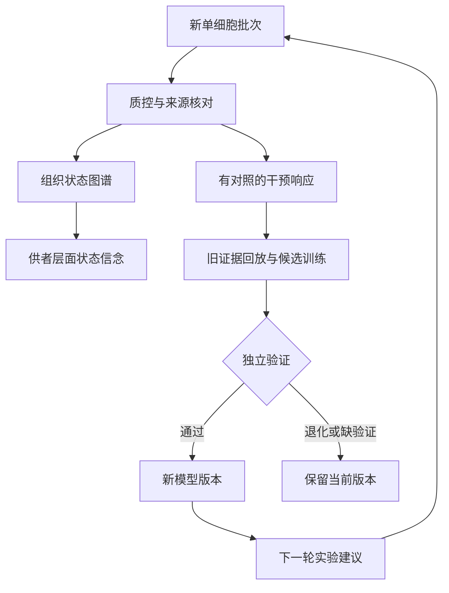

# 虚拟 T 细胞：肝脏、脾脏与持续学习研究核心

## 当前可以做什么

这版把“信念状态—概率响应模型—实验规划—持续学习”落实为可运行 Python 模块，首先解决证据、数据接口、训练与独立评价的闭环。**AGI 是长期研究目标，不是本版已证明的能力。**

| 层 | 本版实现 | 能力边界 |
|---|---|---|
| 单细胞状态图谱 | 原始计数与元数据导入、基础 QC、来源和文件校验、去重、供者/样本/组织分组 pseudobulk | 小规模研究用 SQLite 存储；未实现自动细胞注释、批次校正或亿级细胞训练 |
| 状态信念 | 同一上下文中先平均同供者样本，再统计供者间均值、变异与标准误 | 描述性统计；只有一个供者时不报告供者间标准误；不学习细胞间因果作用 |
| 响应信念与世界模型 | 固定随机非线性特征 + 多输出 Bayesian regression；显式组织/细胞类型/条件/物种；后验与噪声分开 | 轻量响应代理；输出头独立，未建模整个细胞、时间轨迹或未知机制 |
| 行动规划 | 候选实验相关 Gaussian 单步 Knowledge Gradient / cost，预算与域检查，允许停止 | 单一明确终点、有限候选；不会控制实验仪器 |
| 持续学习 | 旧证据完整回放、新证据训练、独立分组验证、整体/组织/物种/输出升级门槛、版本保留 | gate 是预设研究规则；重复使用验证集仍会产生适应性过拟合风险 |

新测序批次的到达时间是**科研轮次**。`biological_time_hours` 是实验内的生物时间，两者不同。常规破坏性终点测序产生的是不同细胞/样本的快照，不是同一细胞的直接连续轨迹。



图中“干预响应”需要外部合格分析提供匹配对照、明确单位与实验 provenance；导入普通表达矩阵不会自动制造该标签。

## 安装与第一轮运行

```bash
python -m pip install -e .
virtual-t-cell-learn demo --out-dir run_output/learning_demo
python -m unittest discover -s tests
```

基础路径只依赖 NumPy、pandas 和 Python 标准库。`demo` 会生成两个肝脏/脾脏批次、16 个合成细胞、合成响应记录、初始与候选模型、gate、独立测试报告、实验规划和重复导入结果。**其中没有真实生物数据或真实测序。** 输出里每项都保留 `synthetic` 标签。

查看核心结果：

- `run_output/learning_demo/demo_report.json`
- `run_output/learning_demo/atlas_states.jsonl`
- `run_output/learning_demo/atlas_belief.json`
- `run_output/learning_demo/active_model.npz`

规划结果允许 `stop`：若候选排序已经很确定，继续测量的预期决策收益可能不足。停止不等于运行失败。

## 肝脏与脾脏原始数据接口

### 两个输入文件

`counts.csv` 是**细胞 × 基因**宽表，第一列 `cell_id`，其余列为非负整数原始计数。明确测量的零值有效；缺失值、负数与非整数拒绝。已归一化或 log 转换的表达值不能冒充原始计数。

```csv
cell_id,CD3D,CD8A,MS4A1,MT-CO1
cell_1,7,4,0,1
cell_2,0,0,12,1
```

对应的 `metadata.csv` 必须包含：

| 字段 | 含义 |
|---|---|
| `cell_id` | 与计数矩阵一一匹配 |
| `sample_id` | 稳定的独立样本编号；重新导入不能改名冒充新样本 |
| `donor_id` | 稳定的供者或实验动物编号；不能把每个细胞当供者 |
| `organ` | 明确 `liver`、`spleen` 等；来源为血液的数据仍是 `blood` |
| `cell_type` | 外部已检查的细胞类型注释；本工具不会自动推断 |
| `condition` | 对照、疾病或刺激等条件名称 |
| `species` | 建议必填；明确 `human` 或 `mouse`，不要混用同名基因解释 |
| `biological_time_hours` | 可选；真实实验设计支持时填写；未知留空 |

```csv
cell_id,sample_id,donor_id,organ,cell_type,condition,species,biological_time_hours
cell_1,liver_sample_01,donor_01,liver,CD8_T,control,human,
cell_2,spleen_sample_01,donor_02,spleen,B_cell,control,human,
```

这些例子只说明文件格式。实际 donor/sample/organ 必须来自真实记录。所有细胞类型都可保留，后续可构建 T 细胞与其他免疫、基质细胞的背景表示；本版尚未推断它们之间的作用关系。

```bash
virtual-t-cell-learn ingest-counts \
  --counts counts.csv --metadata metadata.csv \
  --atlas run_output/liver_spleen_atlas.sqlite \
  --batch-id batch_001 --source my_stable_study_id

virtual-t-cell-learn atlas-status \
  --atlas run_output/liver_spleen_atlas.sqlite \
  --out-states run_output/current_states.jsonl \
  --out-belief run_output/current_state_belief.json
```

基本 QC 可设置 `--min-counts`、`--min-genes`、`--max-mito-fraction`。默认仅作宽松结构检查，**不是已验证的肝脏/脾脏细胞筛选标准**。阈值需在研究方案中预先定义；本版没有双细胞检测、ambient RNA 去除或细胞注释审核。不同 gene panel 分开计算，未测基因不会填成实测零。

细胞身份由 `source + sample_id + cell_id` 定义，因此不同样本可以复用同一 barcode。改变稳定身份会影响去重。已记录的同一细胞若表达或元数据变化，会报冲突；使用明确版本的数据来源重新分析，而不是悄悄改写历史证据。

若 metadata 包含 `intervention/dose/dose_unit`，这些字段也会参与状态分组；不同处理不能仅靠同一个笼统 `condition` 混在一起。CP10K 的分母是**本次输入 gene panel** 的总 counts；只上传 marker panel 时，不等价于全转录组归一化。每个 gene panel 保持独立。

### 可选 H5AD

```bash
python -m pip install -e '.[atlas]'
virtual-t-cell-learn ingest-h5ad \
  --h5ad batch.h5ad --counts-layer counts \
  --atlas run_output/liver_spleen_atlas.sqlite \
  --batch-id batch_002 --source my_stable_study_id
```

必须明确指定原始计数层，不默认认为 `.X` 就是 raw counts。显式 `--counts-layer X` 代表使用者已确认 `.X` 的计数语义；整数检查不能判断所有误标情况。H5AD 路径依赖可选的 AnnData/h5py；基础开发环境没有这些依赖时，功能测试会明确跳过。部分 AnnData layer 可能整体驻留内存，所以它不代表已经完成大规模磁盘流式训练。

## 持续接收批次

上游流程先完整写入表达矩阵与 metadata，最后把 JSON manifest 原子重命名为 `inbox/batch_001.json`。路径相对于 manifest 所在目录。

```json
{
  "schema_version": 1,
  "batch_id": "batch_001",
  "source": "my_stable_study_id",
  "atlas_evidence_type": "observational",
  "atlas": {
    "counts_csv": "../batch_001/counts.csv",
    "metadata_csv": "../batch_001/metadata.csv"
  }
}
```

```bash
virtual-t-cell-learn sync-inbox \
  --inbox inbox \
  --atlas run_output/liver_spleen_atlas.sqlite \
  --evidence run_output/evidence.sqlite \
  --state-belief run_output/current_state_belief.json \
  --out run_output/last_ingestion.json --watch --interval 30
```

`--watch` 在用户运行该命令的进程中轮询，Ctrl+C 停止。没有由本项目偷偷启动远程服务。每个 manifest 与输入内容都有校验，原封不动的重复导入不会新增细胞；已处理文件内容改变会报告冲突。两个 SQLite 存储分别原子提交，跨存储中断通过幂等重试恢复，不是分布式事务。

目标 atlas 数据库也有独立持久身份：重建数据库后不会沿用旧库的“已导入”状态而漏掉数据。每轮会重新校验输入文件，大型 H5AD 可能产生较大 I/O，当前入口定位为研究规模批次管理。

普通测序批次更新图谱和描述性状态信念。下节的响应 JSONL 可以在同一 manifest 中以 `"responses_jsonl": "../responses.jsonl"` 提交，但不会仅因为有一份 count matrix 就自动推导干预标签。

### 在本地启用有门槛的自动响应更新

已有初始响应模型后，可创建 `learning_config.json`，路径相对于这个配置文件：

```json
{
  "model_path": "run_output/current_model.npz",
  "replay_path": "initial_training.jsonl",
  "validation_path": "independent_validation.jsonl",
  "output_dir": "run_output/continual_updates",
  "max_relative_regression": 0.05,
  "allow_synthetic": false,
  "promote": true
}
```

将 `--learning-config learning_config.json` 加到 `sync-inbox` 命令。每轮批次成功入库后，系统会从 evidence journal 收集旧训练证据和待学习的新响应，训练候选、评测并仅在 gate 通过后原子升级当前模型。旧模型、候选、gate 与信念 sidecar 保留。相同的被拒数据不会在每次轮询重新训练；新证据到达后会与未接受证据一起再次提出候选。没有新响应时只更新图谱；批次错误会暂停该轮响应更新并记录原因。

`replay_path` 用来首次登记当前模型完整的原始训练记录。之后已接受的新证据保存在 journal，形成后续回放集。`promote:false` 可让循环只保存候选与 gate。该进程需要用户在自己的运行环境中启动；本次开发没有接通测序设备或长期后台服务器。

本版模型升级使用 POSIX 文件锁，支持 Linux/macOS/WSL。原生 Windows 环境可先在 WSL 运行完整示例和自动升级流程；基础导入、训练接口不需要 POSIX 锁。模型与 belief sidecar 各自原子替换，读取时可核对同一 `model_id`；升级写入失败会恢复旧模型。

## 真实响应记录、训练与升级

响应记录用 JSONL，一行一个独立实验单元的多输出结果。核心字段如下：

```json
{
  "observation_id": "study:experiment:readout",
  "source_record_id": "original_assay_record_id",
  "experiment_id": "study:experiment",
  "group_id": "independent_donor_or_target_group",
  "organ": "liver",
  "species": "human",
  "cell_type": "CD8_T",
  "condition": "defined_condition",
  "intervention": "defined_intervention",
  "evidence_type": "experimental_summary",
  "source": "my_stable_study_id",
  "features": {"pre_intervention_descriptor": 0.5},
  "outcomes": {"readout": 0.2},
  "outcome_units": {"readout": "log2_fold_change"},
  "measurement_sd": {"readout": 0.1}
}
```

以上数值仅说明格式，不能作为真实证据。`features` 应来自实验前状态、干预身份的外部表征、真实剂量/时间及条件，不能包含结果或从干预结果计算的特征。`intervention` 字符串是 provenance，不会自动变成生物学编码。需要建模的剂量、时间必须显式进入 numeric `features`；仅作为元数据填写不会让模型学到这些作用。

缺失 outcome 直接省略该 key，不能补零。所有记录需同一特征名称集，outcome 单位一致。测量 SD 未知时省略，模型残余项会吸收部分未知噪声，不能因此声称已分离全部生物/技术变异。

```bash
virtual-t-cell-learn train \
  --records training.jsonl --out-model run_output/current_model.npz

virtual-t-cell-learn evaluate \
  --model run_output/current_model.npz \
  --records independent_test.jsonl --out run_output/test.json

virtual-t-cell-learn update \
  --model run_output/current_model.npz \
  --replay training.jsonl --new new_responses.jsonl \
  --validation independent_validation.jsonl \
  --out-dir run_output/update_001 --promote-if-accepted
```

训练时排除普通 observational 图谱、模型预测和状态快照。合成数据仅在显式 `--allow-synthetic` 下用于独立的软件测试，仍不能混入真实数据。

更新必须回放全部旧训练 ID 与原始内容。旧/新训练与验证的 observation、experiment、group 均不得重叠。对持续供者队列，`group_id` 应能防止同一供者泄漏；按干预靶点泛化时按靶点分组。当前模型需有的每个组织与物种都要有独立验证。升级比较各输出、各组织及组织内输出，防止整体均值改善掩盖局部退化。新组织还需超过训练均值基线。候选保存为独立版本；加 `--promote-if-accepted` 才会在通过后替换当前文件并保留旧模型。

不要把同一套验证集无限重复使用。保留最终封存测试集，定期增加独立供者、批次和前瞻性实验验证。阈值目前是预设的数值 gate，并不是统计显著性或临床有效性证明。

## 实验规划

候选记录保持相同 feature/context schema，`evidence_type` 为 `model_prediction`，`outcomes` 和 `outcome_units` 为空，另加唯一 `candidate_id` 与正值 `cost`。

```bash
virtual-t-cell-learn plan \
  --model run_output/current_model.npz \
  --candidates candidates.jsonl --outcome readout \
  --budget 5 --out run_output/next_experiment.json
```

规划器比较做一次测量后“最佳候选的后验均值”预期能改善多少，并除以成本。成本有自己的预算单位，不直接从表达变化中相减。候选间的共同不确定性不会自动变成辨别价值。未见器官、物种、上下文组合或超出特征范围的候选默认排除；显式外推不能消除证据缺口。

当前版本只优化一个明确输出，未实现多终点约束或多步策略，也不会发送实验指令。

## 已有公开数据的可复现检验

```bash
python scripts/benchmark_learning_core.py
```

此命令导入仓库的 `models/gse314342_primary_cd4_virtual_t_cell.npz`，使用 9 个预先固定读出与固定拆分。512 个靶点的 3 个条件放在同一组，共 1536 条**已处理实验汇总**。初始训练 307 个靶点，新证据 77 个靶点，验证与测试各 64 个靶点。

该来源是人外周血 CD4 T 细胞。GEO 的[研究记录](https://www.ncbi.nlm.nih.gov/geo/query/acc.cgi?acc=GSE314342)与[原始样本记录](https://www.ncbi.nlm.nih.gov/geo/query/acc.cgi?acc=GSM9393885)保留物种、组织和来源。适配器拒绝把它重新标成肝脏或脾脏。

默认读出为 IL2、IFNG、TNF、PDCD1、TOX、MKI67、GZMB、CD3D、FOXP3；仅 finite effect 且 positive SE 的项进入训练。原 archive 的 `baseline` 来自 DE `baseMean` 汇总，不能保证干预前，因此没有作为输入。使用仓库固定 pathway/network 注释与 target/readout 身份关系作为 20 个输入特征。

**最重要的限制是：512 个靶点仅形成 7 种输入向量。** 大部分靶点缺少现有先验注释，模型无法区分它们。开发时的固定测试结果记录在 [reference_benchmark_summary.json](reference_benchmark_summary.json)，详细过程在 [reference_benchmark.json](reference_benchmark.json)。其中包括与训练均值、零效应、线性模型的比较，以及真实发生的升级拒绝原因。不要把轻量流程跑通解读为已经证明了新机制泛化。

该检验沿用经过全数据选择的已有 archive，只按靶点分组，不是供者独立、跨研究或前瞻性验证；因此不能作为无偏生物发现性能结论。后续真正验证需从原始数据起固定预处理和拆分。

## 向肝脾生物学模型推进的下一步

1. 接入真实、可追踪来源的肝脾 raw counts 和完整样本表，明确人/鼠、健康/疾病、处理与采样时间，先检查覆盖和质量。
2. 建立可学习的细胞状态与组织背景编码器，保留细胞群体分布；将供者、批次与物种作为需要检验的因素，不把组织标签当机制。
3. 构造来源明确、严格不含结果泄漏的干预表征，替换覆盖稀疏的静态先验；把真实干预、对照、时间及功能读出接入响应模型。
4. 对新供者、新扰动与新组织分别留出评测，使用简单线性、条件均值等基线；只有可重复改进才扩大模型。
5. 进行一条小规模前瞻性科研闭环，用真实实验效用与资源预算评价规划策略，再研究跨任务迁移。

批次校正、细胞注释、跨组织迁移、TCR 克隆信息、组织微环境与空间关系均是后续模块，不是本版已有实证。持续增加细胞数量只有在来源、重复、对照和评价协议正确时才会增加可用知识。

## 方法依据

- Domínguez Conde et al., *Science* 2022, [Cross-tissue immune cell analysis reveals tissue-specific features in humans](https://doi.org/10.1126/science.abl5197)：支持保留组织背景与细胞亚型差异的研究动机。
- Squair et al., *Nature Communications* 2021, [Confronting false discoveries in single-cell differential expression](https://doi.org/10.1038/s41467-021-25960-2)：生物重复变异和 pseudobulk 统计单位的依据。
- 上述论文不是本实现算法有效性的背书；本实现的证据是可复现代码、测试和明确限定的运行结果。
